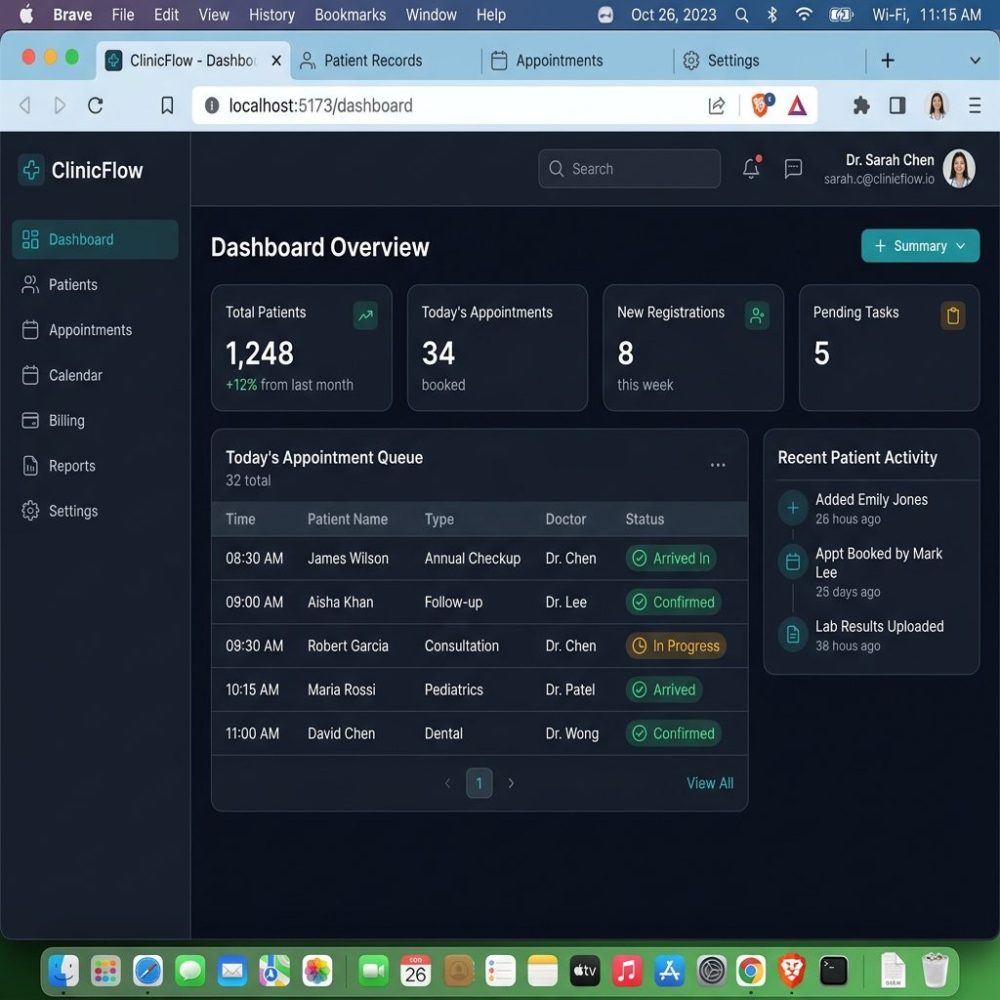

# 🏥 ClinicFlow - Modern Clinic & Patient Management System

ClinicFlow is a streamlined, feature-rich clinic management web application designed for healthcare facilities, doctors, administrators, and patients. It streamlines appointment scheduling, patient queue management, electronic medical records (EMR), doctor availability tracking, billing, and telemetry analytics.

---

## 🎨 Interface Preview

Below is a snapshot of the **ClinicFlow** dashboard interface featuring live patient queues, schedule calendars, appointment metrics, and doctor management stats:



---

## ✨ Key Features

- 📅 **Dynamic Appointment Scheduling**: Drag-and-drop & calendar view for patient bookings.
- 🧑‍⚕️ **Doctor & Staff Management**: Track availability, specializations, and working hours.
- 📊 **Real-time Analytics Dashboard**: Monitor daily patient visits, active consultations, and revenue trends.
- 📋 **Patient Queue & EMR**: Integrated electronic medical records, visit history, and prescription notes.
- 🔐 **Role-based Authentication**: Secure access controls for Admins, Doctors, Nurses, and Receptionists.

---

## 🏗️ Tech Stack

- **Frontend**: React 19, Vite, Tailwind CSS, Radix UI, Lucide Icons, Emotion & Material UI components
- **Backend**: Node.js / Express, SQL database (Schema provided in `clinicflow-schema.sql`)
- **State & Routing**: React Router v7, React Hook Form, Recharts

---

## 🚀 Quick Start & Installation

### Prerequisites
- Node.js (v18.x or higher)
- npm or pnpm

### 1. Clone the Repository
```bash
git clone https://github.com/your-username/Clinicflow-web-app.git
cd Clinicflow-web-app
```

### 2. Frontend Setup
```bash
cd clinicflow-frontend
npm install
npm run dev
```
The frontend application will launch locally at `http://localhost:5173`.

### 3. Backend Setup
```bash
cd ../clinicflow-backend
npm install
npm start
```

### 4. Database Setup
Execute `clinicflow-schema.sql` against your target SQL database instance to populate the initial tables and schemas.

---

## 📜 Repository Structure

```
Clinicflow-web-app/
├── clinicflow-frontend/      # Vite + React frontend application
├── clinicflow-backend/       # Node.js backend server API
├── docs/                     # Documentation assets and screenshots
│   └── clinicflow-ui.png     # Application UI preview
├── clinicflow-schema.sql     # Database initialization script
├── run-all-services.ps1      # PowerShell startup script for all services
└── README.md                 # Project documentation
```

---

## 🤝 Contributing

Contributions are always welcome! Feel free to open issues or submit pull requests to improve features, performance, or styling.

---

## 📄 License

This project is licensed under the [MIT License](LICENSE).
